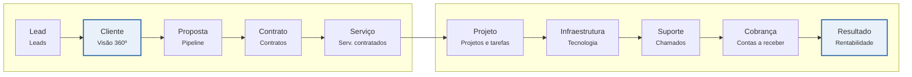

# Jornadas e mapa de telas

[← Índice](README.md)

Todo o sistema segue um único ciclo: o lead vira cliente, o cliente gera contratos e serviços, e serviços geram operação, infraestrutura, cobrança e margem. Cada etapa tem uma tela dona.

As duas caixas em destaque são as telas que respondem às perguntas de negócio: a Visão 360º (quem é o cliente e o que ele tem) e a Rentabilidade (quanto ele deixa).

**Jornadas-chave do MVP**

1. **Fechar um negócio** (Comercial): lead → qualificar → converter em empresa + contato + oportunidade → proposta → aprovada → contrato e serviços contratados gerados → recorrências criadas sozinhas.
2. **Fechar o mês** (Financeiro): Dashboard financeiro → Contas a receber, filtro Vencido → registrar pagamentos → Contas a pagar → registrar notas fiscais.
3. **Atender um chamado** (Suporte): busca global pelo cliente → Visão 360º, aba Infraestrutura → abrir chamado → mensagens → Resolvido → horas lançadas.
4. **Revisar a carteira** (Administrador): Dashboard → Rentabilidade por cliente → Visão 360º do cliente com menor margem → contrato e serviços.

**Mapa de telas (menu lateral)**

| Grupo | Telas |
| --- | --- |
| Dashboard | Visão executiva, gráficos, atividades recentes |
| Comercial | Leads, Oportunidades, Propostas, Pipeline |
| Clientes | Empresas (com Visão 360º), Contatos, Contratos, Serviços contratados |
| Operação | Projetos, Tarefas, Suporte, Horas trabalhadas |
| Financeiro | Dashboard financeiro, Receitas, Despesas, Contas a receber, Contas a pagar, Recorrências, Notas fiscais |
| Tecnologia | Aplicações, Servidores, Domínios, Bancos de dados, Integrações, Serviços externos |
| Produtos | Produtos próprios, Assinaturas, Indicadores |
| Gestão | Fornecedores, Documentos, Relatórios, Indicadores, Rentabilidade |
| Administração | Usuários, Permissões, Logs, Configurações |

Na barra superior, sempre visíveis: busca global (⌘K), notificações e menu do usuário. O Catálogo de serviços fica em Administração → Configurações, porque o documento original não o coloca no menu.
