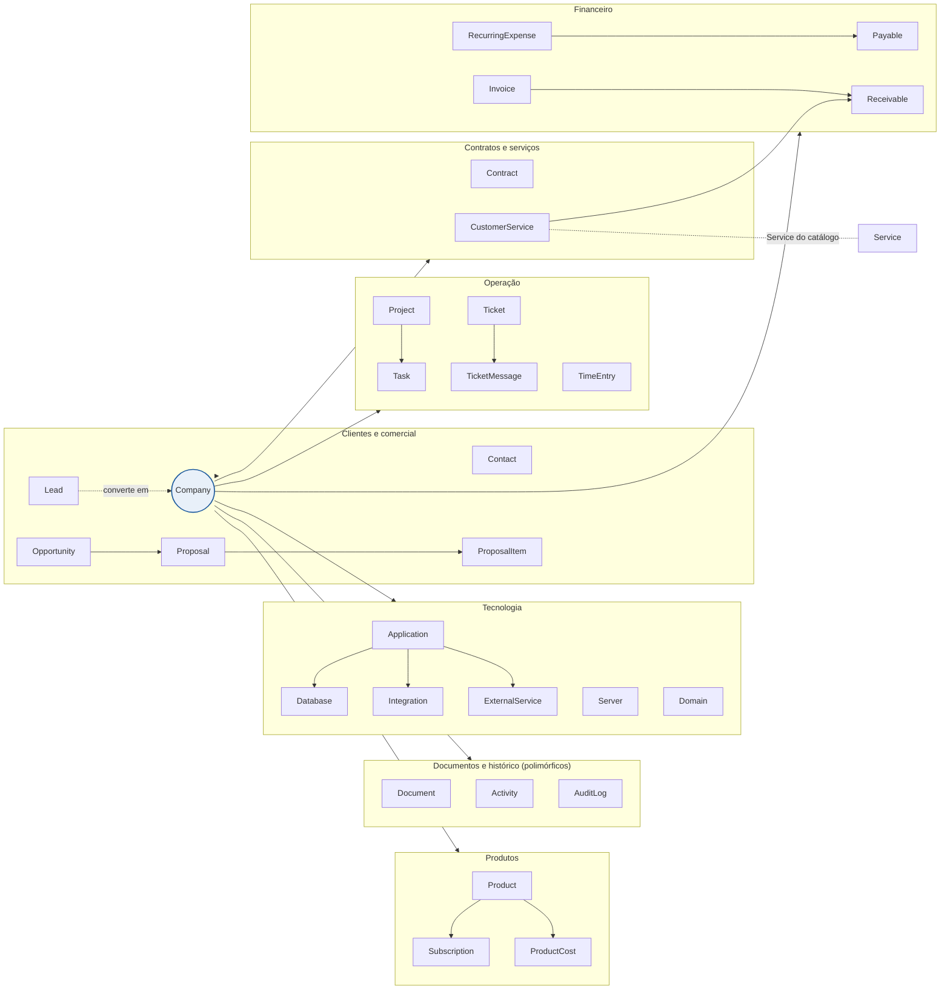

# Modelo de dados

[← Índice](README.md)

O modelo gira em torno de Company: quase todo registro operacional, financeiro e tecnológico pertence a uma empresa, e é isso que permite montar a Visão 360º com uma consulta por aba. Nomes seguem a convenção Rails, em inglês e no singular.

Fora do eixo da empresa: User, Role (perfil com a matriz de permissões), Notification, Service (catálogo), Supplier, Product, Setting (listas e prazos configuráveis), ExchangeRate (cotações PTAX por dia) e RecurrenceRun (execuções da rotina de recorrências).

**Receita e despesa são uma entidade só cada.** Receivable é todo valor a receber: as telas Receitas (por competência) e Contas a receber (por vencimento) são duas visões dele. Payable é o mesmo para despesas e contas a pagar. Status de ambos: Previsto, Pendente, Pago, Vencido, Cancelado.

**Tecnologia (fase 6).** No código, Application é o model `App` (tabela `apps`), para não colidir com ApplicationRecord e ApplicationPolicy. A hospedagem da aplicação é polimórfica (Server ou ExternalService). Ticket ganhou a aplicação afetada; Payable e RecurringExpense, o serviço externo. ProductCost guarda o custo mensal de cada produto, mês a mês, para os indicadores.

**Recorrências (fase 5).** O próprio serviço contratado é a regra da receita recorrente (valor, periodicidade e dia de vencimento): não há entidade RecurringCharge separada. Do lado das despesas, a regra é RecurringExpense. Os títulos gerados guardam a origem (customer_service_id ou recurring_expense_id) e são únicos por competência.

As ligações que geram comportamento automático são três: CustomerService gera Receivable; Payable com centro de custo em uma Company entra no custo direto dela; ExternalService pago pela DevBatista também (assim como Server e Domain pago pela DevBatista). Payable ligado a um ExternalService representa o mesmo gasto e não deve ser somado duas vezes na rentabilidade.

**Regras de integridade para o time de desenvolvimento**

| Regra | Onde |
| --- | --- |
| CNPJ único e validado | Company |
| Um único contato principal por empresa | Contact |
| Motivo obrigatório quando o status é Perdido | Lead, Opportunity |
| Números sequenciais gerados pelo sistema | Contract, Ticket |
| MRR calculado, nunca digitado (mensal, ÷ 3, ÷ 6, ÷ 12; avulso fora) | CustomerService |
| Títulos gerados uma única vez por competência | CustomerService → Receivable, RecurringExpense → Payable |
| Moeda original + valor em R$ na data do pagamento | Payable, ExternalService |
| Nenhum campo de senha, chave ou token | Application, Server, Database, Integration, ExternalService |
| Associação polimórfica (record_type + record_id) | Document, Activity, AuditLog |
| Registro imutável: sem update nem destroy | AuditLog |
| Total da proposta = soma dos itens | Proposal, ProposalItem |
| Lead só vai até Qualificado; daí em diante o pipeline move a oportunidade | Lead, Opportunity |
| external_id para o HubSpot | Company, Contact, Lead, Opportunity |
